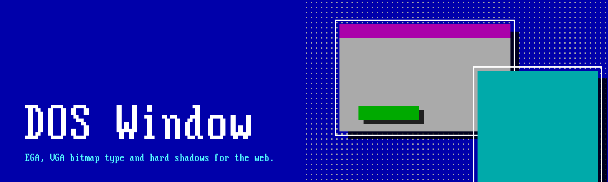
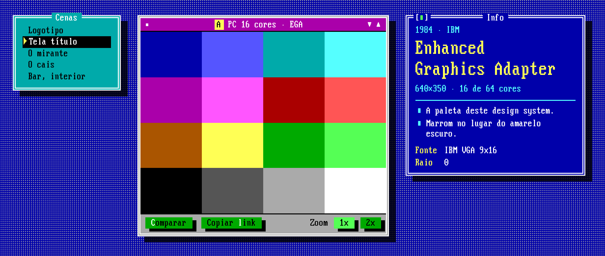
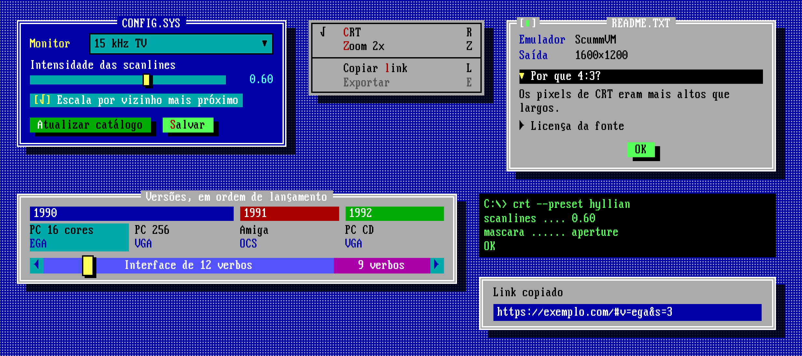
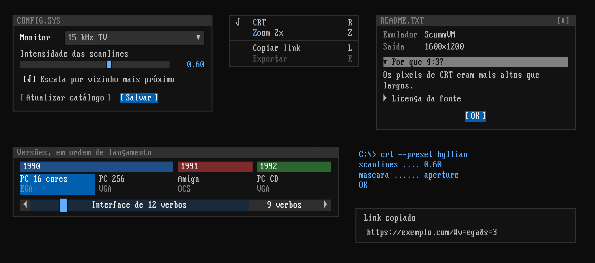
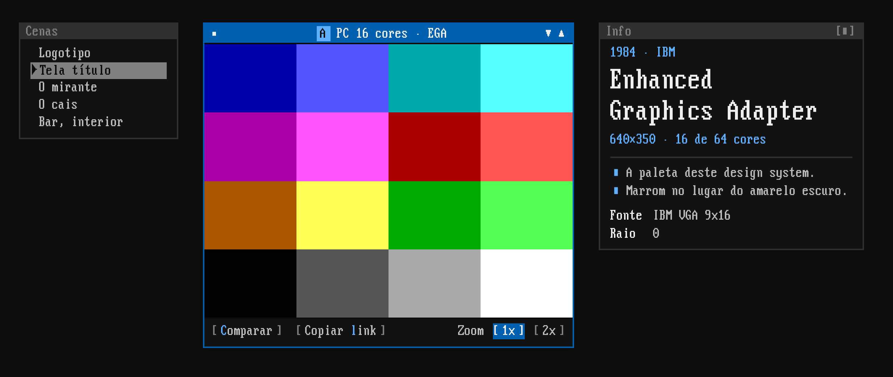
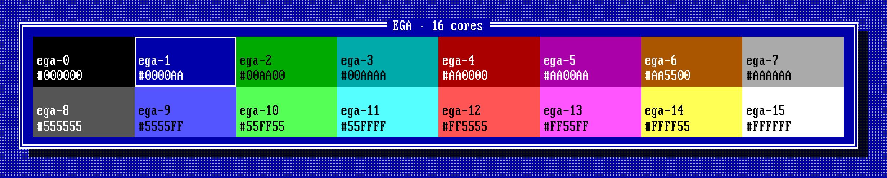
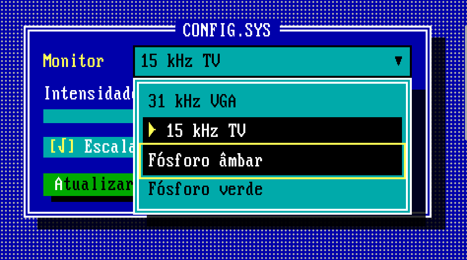

<p align="center">
  <picture>
    <source media="(prefers-color-scheme: dark)" srcset="docs/img/cover-dark.png">
    
  </picture>
</p>

<p align="center">
  <b>Interfaces web vestidas de aplicativo DOS em modo texto.</b><br>
  Paleta EGA de 16 cores · fonte bitmap IBM VGA · janelas com borda dupla · sombras duras · zero raio.<br>
  Um CSS, uma fonte, um script opcional — e uma <b>skill</b> que ensina Claude Code e Codex a usar tudo isso direito.
</p>

<p align="center">
  
  
  
  
</p>

---

## Sumário

- [Sumário](#sumário)
- [O que é](#o-que-é)
- [Instalar a skill](#instalar-a-skill)
- [Usar com um agente](#usar-com-um-agente)
- [Usar sem agente (CSS puro)](#usar-sem-agente-css-puro)
- [Temas](#temas)
- [Fundamentos](#fundamentos)
- [Componentes](#componentes)
- [Tokens](#tokens)
- [Seletor no tema](#seletor-no-tema)
- [Estrutura do repositório](#estrutura-do-repositório)
- [Créditos e licenças](#créditos-e-licenças)

## O que é

**DOS Window** é um design system que recria a linguagem dos aplicativos DOS em modo texto da linha Turbo Vision / Norton: barra de menu cinza com letras de atalho, desktop azul pontilhado, janelas com título sobre a borda, seleção em vídeo inverso e barra de atalhos no rodapé.

Ele existe em dois formatos neste repositório:

| | Para quem | O que tem |
|---|---|---|
| **Design system** | Qualquer projeto web | `dos-window.css` (tokens + fonte + componentes), `dos-select.js`, fonte IBM VGA, `tokens.json` |
| **Skill `dos-window`** | Claude Code e Codex | `SKILL.md` com as regras que o agente precisa seguir, guia de marca, referência de componentes e checklist de revisão |

<p align="center">
  
</p>

## Instalar a skill

```bash
git clone https://github.com/dbonates/dos-window-skill.git
cd dos-window-skill
./install.sh            # Claude Code + Codex
./install.sh claude     # só Claude Code  → ~/.claude/skills/dos-window
./install.sh codex      # só Codex        → ~/.codex/skills/dos-window  (respeita $CODEX_HOME)
```

- Reinstalar é seguro: a versão anterior vai para `~/.claude/skill-backups/` ou `~/.codex/skill-backups/`, **fora** da pasta `skills/`, para não ser carregada como skill duplicada.
- Reinicie as sessões abertas do Claude Code / Codex depois de instalar.
- Para atualizar: `git pull && ./install.sh`.

<details>
<summary><b>Instalar em outra máquina (Raspberry Pi, servidor, container)</b></summary>

O instalador é bash puro e funciona igual em Linux.

```bash
# na máquina remota
git clone https://github.com/dbonates/dos-window-skill.git ~/dos-window-skill
cd ~/dos-window-skill && ./install.sh codex
```

Se o agente roda como serviço com outro usuário ou outro `CODEX_HOME`, instale para ele:

```bash
sudo -u USUARIO_DO_SERVICO CODEX_HOME=/caminho/do/codex ./install.sh codex
```

Em Docker, a pasta `skills/` precisa estar num volume montado no container. Reinicie o serviço depois.

</details>

## Usar com um agente

Depois de instalada, a skill é ativada quando você pede algo no estilo:

```text
> monta a landing page do projeto com o DOS Window
> converte esta página para o visual DOS / EGA
> cria um painel de configurações estilo Turbo Vision
```

O agente lê o `SKILL.md`, copia `dos-window.css`, `dos-select.js` e a fonte para o projeto, parte do template e monta a página com os componentes documentados. Antes de entregar, segue o checklist de revisão da skill: botão normal vs. primário, seletores abertos com mouse e teclado, contraste nos dois temas, layout no celular e atalhos que realmente funcionam.

## Usar sem agente (CSS puro)

Copie `dos-window/assets/dos-window.css`, `dos-window/assets/dos-select.js` e a pasta `dos-window/assets/fonts/` para os estáticos do seu projeto (mantendo `fonts/` ao lado do CSS):

```html
<!doctype html>
<html lang="pt-BR" data-theme="ega">
<head>
  <link rel="preload" href="fonts/ibm-vga-4x3.woff2" as="font" type="font/woff2" crossorigin>
  <link rel="stylesheet" href="dos-window.css">
  <script src="dos-select.js" defer></script>
</head>
<body class="dw-desk dw-app">
  <nav class="dw-menubar">
    <a class="dw-menu-btn" href="/" aria-current="page"><span class="dw-k">I</span>nício</a>
    <span class="dw-right">MEU SITE · subtítulo</span>
  </nav>
  <main class="dw-view">
    <section class="dw-win" aria-labelledby="t">
      <h2 class="dw-win-title">README.TXT</h2>
      <h1 id="t" class="dw-h2">Olá, DOS.</h1>
      <p class="dw-p">Texto em branco sobre azul EGA.</p>
      <div class="dw-btns">
        <a class="dw-btn" href="#">Atualizar</a>
        <a class="dw-btn is-hot" href="#">Salvar</a>
      </div>
    </section>
  </main>
  <footer class="dw-status">
    <span class="dw-right">fonte IBM VGA por VileR, int10h.org (CC BY-SA 4.0)</span>
  </footer>
</body>
</html>
```

Abra [`examples/gallery.html`](examples/gallery.html) por um servidor local (`python3 -m http.server` na raiz do repositório) para ver todos os componentes funcionando e alternar o tema no menu.

Em React, Svelte, Astro etc., importe o mesmo CSS global e use as mesmas classes. Em Tailwind, mapeie `tokens.json` para `theme.extend.colors` em vez de copiar hex.

## Temas

Troque com `data-theme` no `<html>`. Cores mudam pelos tokens; diferenças de estrutura (título em faixa, botões entre colchetes, sem sombras) estão em `[data-theme="dark"]` no próprio CSS.

| `data-theme="ega"` (padrão) | `data-theme="dark"` |
|---|---|
|  |  |
| Desktop azul pontilhado, borda dupla branca, título sobre a borda, botões verdes com sombra dura, acentos amarelo e ciano | Fundo `#0c0c0c` liso, borda 2px `#303030`, faixa de título cinza, botões `[ entre colchetes ]`, acento azul `#5fafff`, sem sombras |

<p align="center">
  
</p>

## Fundamentos

| | Regra |
|---|---|
| **Cor** | Só as 16 cores EGA, sempre por token semântico (`--win`, `--bar`, `--heading`, `--meta`, `--btn`…). Nunca hex solto. |
| **Tipo** | Uma família (`--font-vga`), dois tamanhos: 16px para tudo, 32px para títulos (`.dw-h2`). Peso 400. Hierarquia por cor: amarelo = título/rótulo, ciano = meta, branco = texto. |
| **Forma** | Raio 0. Sombras duras, sem blur, para direita/baixo (`--shadow-win` 14×12, `--shadow-btn` 8×6). Sem gradientes além dos pontos do desktop. |
| **Janelas** | Todo bloco é uma `.dw-win`: azul (conteúdo), `.grey` (diálogos, mídia), `.teal` (listas). Título sobre a borda com `.dw-win-title`. |
| **Seleção** | Vídeo inverso (preto/branco) com ► amarelo. Hover só clareia o texto. |
| **Botões** | Normal (`.dw-btn`, EGA‑2) e primário (`.dw-btn.is-hot`, EGA‑10) têm a mesma forma; muda só a cor. Pressionado afunda 4×3px. |
| **Foco** | Contorno amarelo de 2px, offset 2px. |
| **Ícones** | Glifos CP437: ► ◄ ▲ ▼ ■ • √ `[■]`. Sem bibliotecas de ícones, sem emoji. |
| **Texto** | Tom de manual de software: curto e factual. Letra de atalho em `.dw-k`, seções em MAIÚSCULAS, diálogos fecham com OK. |
| **Responsivo** | Abaixo de ~700px as janelas empilham; itens `.dw-opt` da barra de status somem. |

O guia completo está em [`dos-window/references/brand.md`](dos-window/references/brand.md).

## Componentes

Todos são HTML semântico + classes `dw-*`. O HTML de referência de cada um está em [`dos-window/references/components.md`](dos-window/references/components.md).

| Componente | Classe base | Uso |
|---|---|---|
| Desk | `.dw-desk.dw-app` | Moldura da página: menu, desktop, status |
| MenuBar | `.dw-menubar` › `.dw-menu-btn` | Navegação no topo, com letra de atalho |
| StatusBar | `.dw-status` | Atalhos de teclado e contagens no rodapé |
| Window | `.dw-win` · `.grey` · `.teal` | A unidade de layout |
| Button | `.dw-btn` · `.is-hot` · `[aria-pressed]` | Ações normais, primárias e toggles |
| List | `.dw-list` › `.dw-list-item` | Navegação de uma escolha em janela teal |
| ScreenFrame | `.screenwin` › `.dw-cap` + `.dw-screen` + `.dw-foot` | Imagem/vídeo 4:3 com legenda e controles |
| InfoPanel | `.dw-h2` `.dw-meta` `.dw-rule` `.dw-notes` `.dw-dl` | Tipografia de conteúdo |
| Disclosure | `details` › `summary` (dentro de `.dw-win`) | FAQ, notas, changelog |
| Field | `select[data-dw-select]` · `.dw-range` · `.dw-chk` | Seletor no tema, slider, opção marcada |
| Dropdown | `.dw-dropdown` › `.dw-dd-item` | Menu suspenso com atalhos |
| Timeline | `.dw-band` · `.dw-thumb` · `.dw-track` | Navegação em ordem com faixas e trilho |
| Dialog | `.dw-win.grey[role=dialog]` | Caixa estilo `README.TXT` com OK |
| Console | `.dw-console` · `.dw-toast` | Saída de terminal e avisos curtos |

## Tokens

<p align="center">
  
</p>

Os tokens vêm em [`dos-window/assets/tokens.json`](dos-window/assets/tokens.json) e como variáveis CSS no `dos-window.css`:

- **Paleta:** `--ega-0` … `--ega-15`, iguais nos dois temas.
- **Semânticos** (mudam por tema): `--desk`, `--bar`, `--win`, `--win-grey`, `--win-teal`, `--ink`, `--heading`, `--meta`, `--hotkey`, `--btn`, `--btn-on`, `--select-bg`, `--marker`, `--caption`, `--field`, `--accent-a`, `--accent-b` e outros, cada um com nota de uso no JSON.
- **Espaço:** `--space-1` (2px) … `--space-8` (26px). **Raio:** `--radius-none`. **Traços:** `--stroke-window` (6px), `--stroke-line` (2px). **Sombras:** `--shadow-win`, `--shadow-btn`, `--shadow-btn-pressed`, `--shadow-chip`.
- **Escala:** `--u` multiplica todas as medidas (vai para 2 sozinho em telas ≥ 3200×1700).

## Seletor no tema

<p align="center">
  
</p>

O popup nativo do `<select>` não segue o tema. O `dos-select.js` troca o popup por uma lista teal (Popover API), sem perder o `select` original:

```html
<div class="dw-lrow">
  <label for="monitor">Monitor</label>
  <select id="monitor" name="monitor" data-dw-select>
    <option>31 kHz VGA</option>
    <option>15 kHz TV</option>
  </select>
</div>
<script src="dos-select.js" defer></script>
```

- O valor continua no `select`, então formulários e `FormData` funcionam sem mudança.
- Teclado: ↑ ↓ Home End navegam, uma letra pula para a opção, Enter escolhe, Esc fecha e devolve o foco.
- Campo criado depois do carregamento: `enhanceDosSelect(select)`. Mudou `.value` por código: dispare `change`.
- Onde não há Popover API, o `select` nativo continua funcionando.

## Estrutura do repositório

```text
dos-window-skill/
├── install.sh                  instalador (Claude Code / Codex)
├── dos-window/                 ← a skill (é isto que vai para ~/.claude/skills e ~/.codex/skills)
│   ├── SKILL.md                regras e fluxo para o agente
│   ├── assets/
│   │   ├── dos-window.css      tokens + @font-face + componentes
│   │   ├── dos-select.js       seletor no tema
│   │   ├── template.html       esqueleto de página
│   │   ├── tokens.json         tokens para ferramentas
│   │   └── fonts/              IBM VGA 4:3 (woff2) + licença
│   └── references/
│       ├── brand.md            guia de marca completo
│       └── components.md       componentes com HTML de referência
├── examples/gallery.html       galeria viva com troca de tema
└── docs/                       imagens deste README e a fonte da capa
```

## Créditos e licenças

- **Código** (CSS, JS, scripts, documentação): [MIT](LICENSE) © Daniel Bonates.
- **Fonte** `ibm-vga-4x3.woff2`: IBM VGA 9x16 por **VileR**, [The Ultimate Oldschool PC Font Pack](https://int10h.org/oldschool-pc-fonts/), licença [CC BY-SA 4.0](https://creativecommons.org/licenses/by-sa/4.0/). Sites que usam a fonte devem creditar: *"IBM VGA font by VileR, int10h.org (CC BY-SA 4.0)"*.
- **Inspiração:** a interface de [monkeyisland.pages.dev](https://monkeyisland.pages.dev/), por The Paninos off-line. Este projeto reproduz só a linguagem de interface; não inclui marcas, logos nem imagens de jogos.

Histórico de versões em [CHANGELOG.md](CHANGELOG.md).
